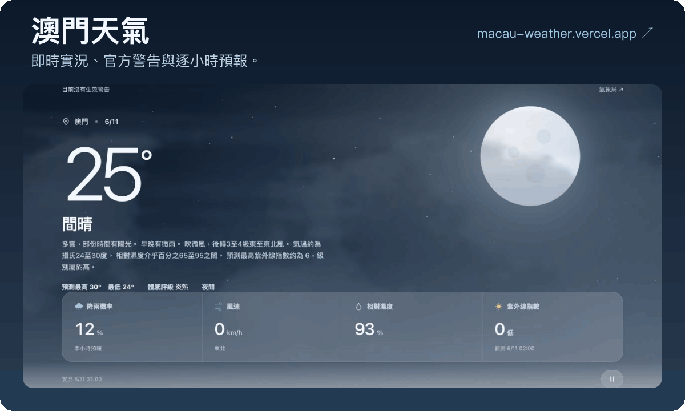
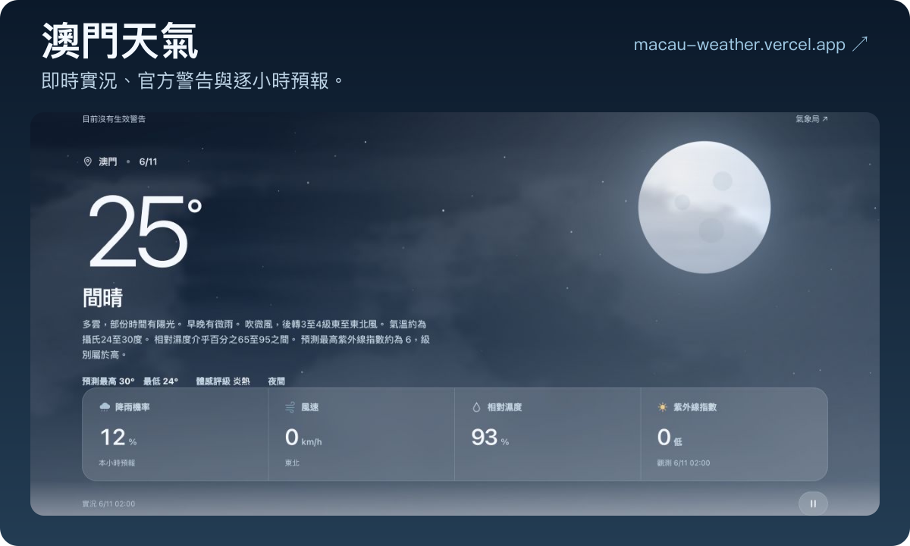

# 澳門天氣

即時實況、官方警告與逐小時預報，放在同一頁。

**[開啟網站 ↗](https://macau-weather.vercel.app)** · [天氣 API](https://macau-weather.vercel.app/api/weather) · [警告 API](https://macau-weather.vercel.app/api/warnings)

[](https://macau-weather.vercel.app)

<details>
<summary>查看靜態預覽</summary>



</details>

*介紹圖為製作時的實際畫面；最新天氣請開啟網站查看。*

## 可以看甚麼

- **現在的澳門**：氣溫、風速、濕度、紫外線，以及當日預測最高／最低溫。
- **置頂官方警告**：颱風、暴雨、季候風、雷暴、風暴潮及海嘯；生效時顯示官方圖示、發出時間及公告連結。
- **接下來的天氣**：未來 12 小時氣溫與降雨機率、官方七日預報。
- **城市環境**：各區氣象站、六站空氣污染物濃度及分區空氣質量指數預報。

天空隨官方實況和澳門日出日落變化，保留暫停動畫及減少動態效果支援。

## 本機啟動

需要 Node.js 22。

```sh
git clone https://github.com/HiNesslio/macau-weather.git
cd macau-weather
npm ci
npm run dev
```

開啟 [localhost:3000](http://localhost:3000)。網頁與 API 會一起啟動，毋須資料庫或 API Key。

## 部署到 Vercel

匯入本儲存庫，使用以下設定；其餘由 `vercel.json` 處理。

| 設定 | 值 |
| --- | --- |
| 框架 | Other |
| 根目錄 | 儲存庫根目錄 |
| 建置指令 | `npm run build` |
| 輸出目錄 | `public` |

正式專案已連接 `main` 分支；亦可在專案目錄使用 `npx vercel --prod` 發布。

## 資料從哪裡來

| 資料 | 來源 | 網頁更新 |
| --- | --- | --- |
| 即時實況、紫外線、氣象站、空氣資料 | 澳門地球物理氣象局 | 每 5 分鐘 |
| 當日高低溫、七日預報 | SMG [`c_7daysforecast.xml`](https://xml.smg.gov.mo/c_7daysforecast.xml) | 每 5 分鐘 |
| 六類警告與信號圖示 | SMG 獨立警告 XML 及官方圖示 | 每分鐘 |
| 逐小時氣溫、降雨機率、日出日落 | Open-Meteo | 每 5 分鐘 |

**最高／最低溫是預報，不是已錄得數值。** 程式按澳門當日日期匹配 `ValidFor`，讀取 `Type 1` 的預測最高與 `Type 2` 的預測最低；沒有當日資料時顯示「—」，不拿別日或實測值代替。API 的 `dailyForecast` 提供日期及來源，`current.observedHigh`／`observedLow` 另存簡報提供的實測高低溫。

缺少資料時顯示「—」或保留並標示上次資料。警告狀態未能確認時會明確提示；收到官方取消狀態才移除原有警告。所有警告以氣象局公告為準。

[完整資料來源及部署說明](./docs/data-and-deployment.md) · [介面與動畫設計說明](./docs/design-notes.md)

## 驗證

```sh
npm test
npm run build
```

目前 30 項測試涵蓋官方欄位、澳門跨日取值、警告生效與取消、缺值及來源失敗，以及前端更新狀態。

## 素材與使用條件

- 雲層來自使用者提供的 `apple-weather-cloud-kit.zip`，依套件說明可自由使用、修改與商用。
- 警告圖示採用未修改的 SMG 官方原圖，來源記錄於[資料說明](./docs/data-and-deployment.md)。
- Open-Meteo 資料須依 [CC BY 4.0](https://creativecommons.org/licenses/by/4.0/) 標示來源；免費 API 限非商業用途，商用請採用其[授權方案](https://open-meteo.com/en/pricing)。
- 本儲存庫尚未指定程式碼授權；公開可見不代表授予其他使用權。

GIF 的可編輯版面、動作設定及原始截圖位於 [`assets/readme/source/`](./assets/readme/source/)。
